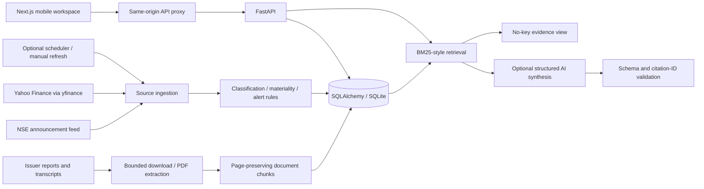

# FINN architecture and contracts

The journey is digest → reason → original filing → company research → page-level evidence. The accountability lens adds a focused cross-document comparison. It avoids pretending that a chat interface alone is an investment agent.

## Service boundaries

`ingestion/market.py`: resolves NSE equity identifiers and downloads completed adjusted daily bars. Provider fundamentals are not financial research evidence. Bars dated today are conservatively excluded until 18:30 IST. Holidays/weekends are represented by actual returned sessions, rather than fabricated weekday bars.

`ingestion/exchange.py`: uses the public NSE announcement endpoint after normal cookie bootstrap. Bounded timeouts, no CAPTCHA bypass. Original source timestamps are interpreted as IST and stored in UTC. Invalid dates are skipped instead of assigned the download date.

`services/materiality.py`: transparent category rules and conservative urgency scores. Board-meeting notices are lowered, not mistaken for published results. An optional structured model call classifies ambiguous filings but cannot raise their score without a deterministic scoring rule.

`services/alerts.py`: deterministic signed closing-price change and volume ratio. The volume baseline uses exactly the preceding N completed sessions, excluding the current one; incomplete baselines do not generate volume alerts. Preferences are persisted and alerts recalculated. The current prototype has one watchlist/preferences set per deployment.

`services/documents.py`: HTTPS public-network checks, issuer/exchange domain allowlist, redirect validation, 20 MB and 600-page limits, issuer identity check, PyMuPDF extraction and page-preserving chunks. Documents with no extractable text fail clearly. Screener is only a link directory; its financial tables are not evidence. Allowlisting and DNS checks reduce SSRF exposure; a production deployment should additionally enforce outbound network restrictions against DNS rebinding and parser sandboxing.

`services/research.py`: BM25-style lexical retrieval without paid embeddings or vector infrastructure. A maximum of six distinct document/page citations feeds a small structured-output model call. Cache keys incorporate question, ticker, retrieved content, provider mode and model. Source text is treated as untrusted input. Schema validation and citation validation reject malformed answers; failure falls back to extractive evidence. This reduces, but cannot mathematically eliminate, unsupported model inference.

`ai/client.py`: one small provider boundary, no stored secrets. Gemini 3.5 Flash-Lite is optional and configured by server-only environment variables. The endpoint receives only the question and relevant public source passages, not the portfolio database. No-key mode incurs no model calls.

`services/calculations.py`: percentages and guidance comparisons in Python. Missing/zero denominators yield null. For negative bases, change is `(current - previous) / abs(previous)`, explicitly explained. Guidance deviation is percentage points from the nearest bound. Operating profit is not silently substituted for EBITDA.

## Persistence

- `companies`: issuer identifiers, domain, verification flag, watched flag.
- `prices`: unique `(ticker, date, mode)`, adjusted close, volume, source and fetch time.
- `announcements`: source filing/attachment identity and content-sensitive fingerprint; UTC date, observation date, score, factors, source and method. Exact identities collapse while distinct attachments and materially changed text remain separately traceable.
- `preferences`: one shared local desk, thresholds, lookback and scope.
- `alerts`: unique `(mode, ticker, session, kind)` key, computed value and threshold.
- `documents` → `chunks`: primary source URL and SHA-256 content checksum, source period, physical PDF page. Chunks reference documents via a foreign key.
- `financials`: unique company/period/reporting-basis/mode; reviewed metric values and primary page. FY2025-Q4 means the Indian financial year ending March 2025. INFY/TCS PAT is attributable to owners; Wipro uses group PAT including non-controlling interests and labels the basis explicitly.
- `guidance`: reviewed original range, metric/currency basis, target period and two source references.
- `research_cache`: deterministic content-sensitive key and validated result.
- `sync_runs`: time-stamped partial successes and failures, not a single misleading healthy flag.
- Startup marks unfinished sync runs `interrupted`, retains partial results and saved source data, and allows a new refresh. The one-worker prototype does not silently claim background jobs resumed after a process restart.
- Notification events retain read history independently of current alert recalculation. Push recipients and an idempotent durable outbox support optional VAPID-backed browser delivery; real device delivery is a separate acceptance check.

Composite mode/date/score indexing supports digest windows. Company and document foreign-key indexes support research. SQLite WAL allows reads during ingestion. Use one backend worker; scheduling/concurrency locks are process-local. PostgreSQL requires a driver and migrations plus a distributed job lock before multiple workers. Changing the connection URL alone is not a complete production migration.

## API

OpenAPI and interactive request schemas are available at `http://127.0.0.1:8000/docs` locally.

| Endpoint | Purpose |
| --- | --- |
| `GET /api/health` | Version, model/scheduler flags, fixed demo clock |
| `GET /api/operations` | Protected source freshness, last sync, bounded process metrics and push outbox counts |
| `GET /api/companies?q=` | Persisted company search |
| `PATCH /api/companies/{ticker}` | Add/remove an indexed company from the watchlist |
| `GET /api/dashboard?mode=demo|sourced` | Stats, company histories, freshness, refresh status |
| `GET /api/announcements` | Time window, ticker, category, priority, routine filters |
| `GET /api/alerts?mode=` | Current EOD rule crossings |
| `GET /api/preferences`, `PUT /api/preferences` | Read/save validated monitoring rules |
| `POST /api/sync`, `GET /api/sync/{id}` | Start/poll a bounded background refresh |
| `POST /api/companies/{ticker}/discover` | Resolve any available NSE equity and discover primary PDFs |
| `GET /api/companies/{ticker}/documents` | Indexed source library |
| `POST /api/documents` | Download and index an approved primary URL |
| `POST /api/research` | Retrieve evidence and optionally synthesize an answer |
| `GET /api/companies/{ticker}/financials` | Reviewed comparable quarterly values and calculated growth |
| `GET /api/companies/{ticker}/guidance` | Same-period guidance versus reported actuals |

The frontend proxy reads `BACKEND_URL` and the shared backend token on the server. In public mode, a separate access code establishes an eight-hour signed HttpOnly/SameSite=Strict session; mutation requests require a matching browser origin. Session JSON is limited to 2,048 bytes, failed sign-ins are throttled and backend rate-limit responses retain Retry-After. This protects one shared desk, without per-user data isolation. The complete tested endpoint inventory, including notification, context and push routes, is in [comprehensive-audit.md](comprehensive-audit.md).

The later verification-gap update adds an explicit trusted public origin (`FINN_PUBLIC_ORIGIN`, with Render's external URL as fallback) for proxy-terminated HTTPS origin checks and Secure cookies. A public minimal frontend `GET /api/ready` checks backend readiness without exposing desk data or credentials. The root container supervisor binds Python to loopback and exposes only Next.js. See [verification-gap-resolution.md](verification-gap-resolution.md) for current 25-operation/248-test evidence; the earlier full audit is retained as history.
