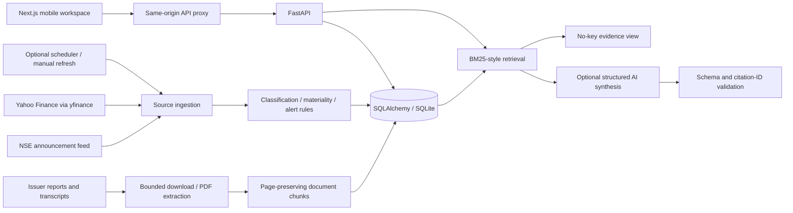

# FINN architecture and contracts

The journey is digest → reason → original filing → company research → page-level evidence. The accountability lens adds a focused cross-document comparison. It avoids pretending that a chat interface alone is an investment agent.

## Service boundaries

`ingestion/market.py`: resolves NSE equity identifiers and downloads completed adjusted daily bars. Provider fundamentals are not financial research evidence. Bars dated today are conservatively excluded until 18:30 IST. Holidays/weekends are represented by actual returned sessions, rather than fabricated weekday bars.

`ingestion/exchange.py`: uses the public NSE announcement endpoint after normal cookie bootstrap. Bounded timeouts, no CAPTCHA bypass. Original source timestamps are interpreted as IST and stored in UTC. Invalid dates are skipped instead of assigned the download date.

`services/materiality.py`: transparent category rules and conservative urgency scores. Board-meeting notices are lowered, not mistaken for published results. An optional structured model call classifies ambiguous filings but cannot raise their score without a deterministic scoring rule.

`services/alerts.py`: deterministic signed closing-price change and volume ratio. The volume baseline uses exactly the preceding N completed sessions, excluding the current one; incomplete baselines do not generate volume alerts. Preferences are persisted and alerts recalculated. The current prototype has one watchlist/preferences set per deployment.

`services/documents.py`: HTTPS public-network checks, issuer/exchange domain allowlist, redirect validation, 20 MB and 600-page limits, issuer identity check, PyMuPDF extraction and page-preserving chunks. Documents with no extractable text fail clearly. Screener is only a link directory; its financial tables are not evidence. Allowlisting and DNS checks reduce SSRF exposure; a production deployment should additionally enforce outbound network restrictions against DNS rebinding and parser sandboxing.

`services/research.py`: BM25-style lexical retrieval without paid embeddings or vector infrastructure. A maximum of six distinct document/page citations feeds a small structured-output model call. Cache keys incorporate question, ticker, retrieved content, provider mode and model. Source text is treated as untrusted input. Schema validation and citation validation reject malformed answers; failure falls back to extractive evidence. This reduces, but cannot mathematically eliminate, unsupported model inference.

`ai/client.py`: one small provider boundary, no stored secrets. OpenAI is optional and configured by environment variables. The endpoint receives only the question and relevant public source passages, not the portfolio database. No-key mode incurs no model calls.

`services/calculations.py`: percentages and guidance comparisons in Python. Missing/zero denominators yield null. For negative bases, change is `(current - previous) / abs(previous)`, explicitly explained. Guidance deviation is percentage points from the nearest bound. Operating profit is not silently substituted for EBITDA.

## Persistence

- `companies`: issuer identifiers, domain, verification flag, watched flag.
- `prices`: unique `(ticker, date, mode)`, adjusted close, volume, source and fetch time.
- `announcements`: unique normalised issuer/title/day/mode fingerprint; UTC date, score, factors, source and method. Re-publication under a new attachment does not duplicate an event. A materially amended filing with the same headline/day can be merged by this conservative MVP key; revision-aware content hashes are a future improvement.
- `preferences`: one shared local desk, thresholds, lookback and scope.
- `alerts`: unique `(mode, ticker, session, kind)` key, computed value and threshold.
- `documents` → `chunks`: primary source URL and SHA-256 content checksum, source period, physical PDF page. Chunks reference documents via a foreign key.
- `financials`: unique company/period/reporting-basis/mode; reviewed metric values and primary page. FY2025-Q4 means the Indian financial year ending March 2025. PAT is attributable to owners, after minority interests.
- `guidance`: reviewed original range, metric/currency basis, target period and two source references.
- `research_cache`: deterministic content-sensitive key and validated result.
- `sync_runs`: time-stamped partial successes and failures, not a single misleading healthy flag.

Composite mode/date/score indexing supports digest windows. Company and document foreign-key indexes support research. SQLite WAL allows reads during ingestion. Use one backend worker; scheduling/concurrency locks are process-local. PostgreSQL requires a driver and migrations plus a distributed job lock before multiple workers. Changing the connection URL alone is not a complete production migration.

## API

OpenAPI and interactive request schemas are available at `http://127.0.0.1:8000/docs` locally.

| Endpoint | Purpose |
| --- | --- |
| `GET /api/health` | Version, model/scheduler flags, fixed demo clock |
| `GET /api/companies?q=` | Persisted company search |
| `PATCH /api/companies/{ticker}` | Add/remove an indexed company from the watchlist |
| `GET /api/dashboard?mode=demo|sourced` | Stats, company histories, freshness, refresh status |
| `GET /api/announcements` | Time window, ticker, category, priority, routine filters |
| `GET /api/alerts?mode=` | Current EOD rule crossings |
| `GET /api/preferences`, `PUT /api/preferences` | Read/save validated monitoring rules |
| `POST /api/sync`, `GET /api/sync/{id}` | Start/poll a bounded background refresh |
| `POST /api/companies/{ticker}/discover` | Resolve any available NSE equity and discover primary PDFs |
| `GET /api/companies/{ticker}/documents` | Indexed source library |
| `POST /api/documents` | Download and index an approved primary URL |
| `POST /api/research` | Retrieve evidence and optionally synthesize an answer |
| `GET /api/companies/{ticker}/financials` | Reviewed comparable quarterly values and calculated growth |
| `GET /api/companies/{ticker}/guidance` | Same-period guidance versus reported actuals |

The frontend proxy reads `BACKEND_URL` and an optional shared backend token on the server. That token prevents direct unauthenticated backend access, but is **not end-user authentication**: visitors to an unprotected frontend can use the proxy. Keep the prototype local/private, or place host authentication in front of the entire application before exposing a shared desk publicly.
